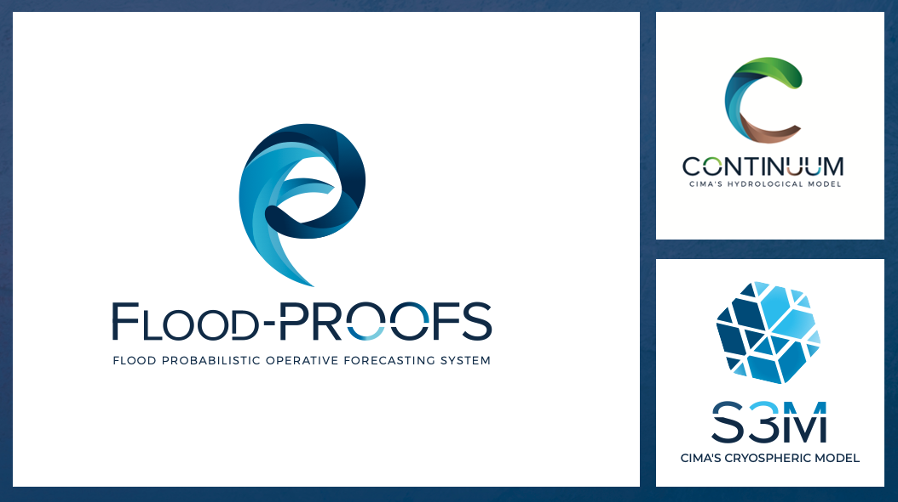

# SHYBOX — Snow and Hydrologic Modeling Toolbox

**SHYBOX** (Snow and HYdrologic toolBOX) connects environmental data, hydrological and snow models, and the analysis of their results. Developed by the **CIMA Research Foundation**, it provides a shared Python framework for research and operational forecasting, including workflows used in Flood-PROOFS systems.

SHYBOX brings the stages of a modeling application into a consistent workflow: prepare observations and weather forecasts, organize model inputs, configure and run simulations, then analyze, display and monitor their outputs. Reusable components handle configuration, datasets, time, logging and processing orchestration.

## Release 1.7.1

Version **1.7.1** adds per-member dataset summaries, execution tracing,
observed/forecast file filtering and NetCDF metadata fixes. The sequential dataset
runner supports planning previews and forcing execution; the experimental
`datasets_parallel` folder is excluded from this release.
See the [changelog](CHANGELOG) for changes and migration notes. Documentation
edition **0.5.0** groups guides into expandable main topics and subtopics.

Runner examples are in [`workflow/runner/execution/`](workflow/runner/execution/)
and dataset preparation examples in [`workflow/runner/datasets/`](workflow/runner/datasets/).
Legacy HMC training material is organized under [`labs/hmc/`](labs/hmc/);
see the [import notes](labs/hmc/IMPORT.rst) before using it. Create a separate
JupyterLab environment with `./setup_shybox_jupyter.sh --python python3.11`,
then open the labs with `./run_shybox_jupyter.sh` ([details](labs/README.rst)).

## What SHYBOX supports

- **Environmental data preparation:** conversion, spatial interpolation, temporal processing, merging and rainfall disaggregation.
- **Dataset planning:** observed and forecast coverage, source cycles, file availability and ensemble organization.
- **Model applications:** configuration and execution workflows for HMC/Continuum and S3M, including ensemble applications.
- **Results and diagnostics:** time-series analysis, maps, figures, interactive viewing and execution monitoring.
- **Reusable workflows:** Python components and JSON configuration that connect these tasks across domains and datasets.

Available workflows and interfaces depend on the selected repository revision and the model version used by an application.

## Models

| Model | Scientific focus | Presentation |
| --- | --- | --- |
| **HMC / Continuum** — Hydrological Model Continuum | Catchment water and energy balances, runoff generation and river discharge, supporting flood forecasting and water-resource studies. | [Appendix A: HMC / Continuum](https://shybox.readthedocs.io/en/latest/appendix_hmc.html) |
| **S3M** — Snow Multidata Mapping and Modeling | Seasonal snow and glacier evolution, stored water and meltwater contributions to hydrological applications. | [Appendix B: S3M](https://shybox.readthedocs.io/en/latest/appendix_s3m.html) |

The numerical models, their executables and domain datasets are maintained separately from the SHYBOX workflow toolbox. The appendices introduce their scientific concepts and references; the user guide explains their use with SHYBOX.

## Documentation

**[Read the Docs](https://shybox.readthedocs.io/en/latest/)** is the home for algorithm descriptions, installation instructions, configuration, operating procedures, examples and development guidance.

| Topic | Guide |
| --- | --- |
| Project structure and components | [Overview](https://shybox.readthedocs.io/en/latest/overview.html) |
| Installation and first application | [Installation](https://shybox.readthedocs.io/en/latest/installation.html) · [Quickstart](https://shybox.readthedocs.io/en/latest/quickstart.html) |
| Configuration and processing | [Configuration](https://shybox.readthedocs.io/en/latest/configuration.html) · [Workflows and analysis](https://shybox.readthedocs.io/en/latest/workflows.html) |
| Dataset planning and preparation | [Dataset planning](https://shybox.readthedocs.io/en/latest/dataset_planning.html) · [Runner execution](https://shybox.readthedocs.io/en/latest/dataset_execution.html) · [Member summaries](https://shybox.readthedocs.io/en/latest/dataset_summaries.html) |
| HMC/S3M execution | [Model runners](https://shybox.readthedocs.io/en/latest/runners.html) |
| Viewing and monitoring | [Hydrapp](https://shybox.readthedocs.io/en/latest/hydrapp.html) · [Monitoring](https://shybox.readthedocs.io/en/latest/monitoring.html) |
| Development and releases | [Development](https://shybox.readthedocs.io/en/latest/development.html) · [Releases](https://shybox.readthedocs.io/en/latest/releases.html) |

Documentation sources and illustrations are maintained in [`docs/`](docs/). Model illustrations are grouped under `docs/_static/images/models/` and bundled with the documentation.

## Project and community

SHYBOX is developed for reproducible environmental modeling and operational hydrometeorological applications. It can use inputs from **[SHYDATA](https://github.com/c-hydro/shydata)** or other observational, forecast and geographic data sources.

- [Source code](https://github.com/c-hydro/shybox)
- [Report an issue](https://github.com/c-hydro/shybox/issues)
- [CIMA Research Foundation](https://www.cimafoundation.org/)
- [Change history](CHANGELOG)

## Citation

Use the metadata in [`CITATION.cff`](CITATION.cff) to cite SHYBOX 1.7.1.
GitHub also provides a “Cite this repository” option. Scientific model references
are listed in the documentation appendices.

## License

SHYBOX is distributed under the [European Union Public Licence v1.2 (EUPL-1.2)](LICENSE). Model software and third-party components retain their own licences and attribution; model references and figure credits are included in the documentation.
