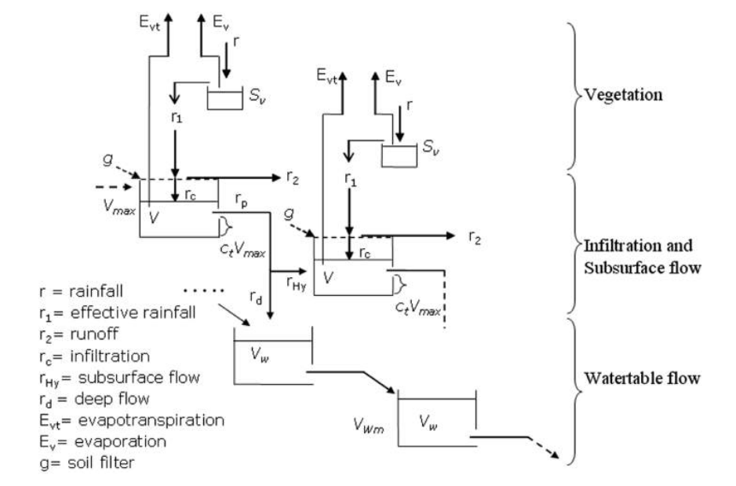
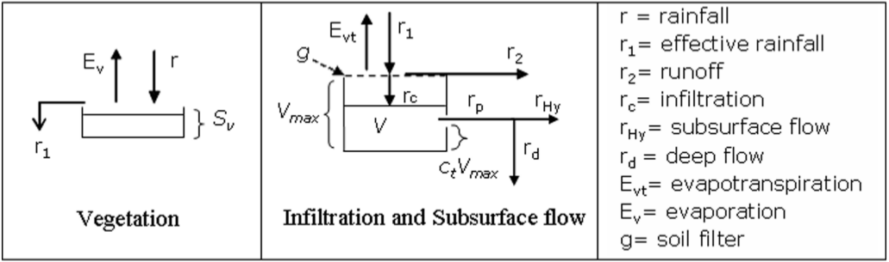

.. _appendix-hmc:

Appendix A: HMC / Continuum
===========================

The Hydrological Model Continuum (HMC) is a continuous, spatially distributed
catchment model developed at CIMA Research Foundation. It represents the
movement and storage of water together with exchanges of energy at the land
surface. Applications include flood forecasting, water-resource assessment and
investigation of catchment response to changing meteorological conditions.

Continuum combines physically interpretable process descriptions with a compact
parameterization. Terrain morphology defines the drainage organization and
helps distribute catchment properties. The scientific background is described
in the `2012 Continuum discussion paper`_ and the `2013 peer-reviewed article`_.
The HMC development documentation, ``hmc-dev/docs/description.rst``, provides
the accompanying process presentation and illustrations.

Water moving through a catchment
--------------------------------

   Continuum water stores and exchanges between neighboring cells. Illustration
   from the HMC documentation, CIMA Research Foundation / Fabio Delogu.
   See the :download:`figure source manifest <_static/images/models/SOURCES.txt>`.

Rainfall can be intercepted by vegetation, infiltrate into soil storage or
contribute to surface runoff. Soil water can feed evapotranspiration,
subsurface drainage and deeper storage. Hillslope and channel routing connect
these local balances into a catchment response and a discharge hydrograph.
The distributed state keeps track of where water is stored as well as how much
leaves a basin.

.. list-table:: Main process groups
   :header-rows: 1
   :widths: 30 70

   * - Process
     - Representation in the model presentation
   * - Vegetation interception
     - A canopy store links interception capacity to vegetation properties and allows intercepted water to evaporate.
   * - Infiltration and soil storage
     - An infiltration formulation derived from the Horton approach connects soil wetness, storage capacity and runoff production.
   * - Subsurface and groundwater flow
     - Soil drainage and deeper storage represent slower transfers and exchanges between neighboring cells.
   * - Hillslope and channel routing
     - Distinct routing descriptions carry surface water through the drainage network derived from terrain morphology.
   * - Surface energy balance
     - Energy exchanges support the simulation of land-surface temperature and evapotranspiration alongside the water balance.

   Vegetation and soil components of the Continuum conceptual scheme.
   Source: HMC model documentation; attribution as above.

States, observations and interpretation
---------------------------------------

Discharge is an important model result, but it is not the only quantity of
interest. Soil moisture, land-surface temperature, evapotranspiration and water
storage provide complementary information about the simulated catchment.
The model documentation discusses how distributed observations, including
remotely sensed surface temperature, can help constrain parameter choices and
evaluate the representation of catchment processes.

Initial soil and groundwater conditions influence a continuous simulation.
Calibration, initialization and evaluation therefore concern the evolution of
the basin over time, rather than only the peak of an individual flood.
The process descriptions and figures here introduce the model concepts;
available options depend on the selected HMC executable and version.

HMC within SHYBOX
-----------------

SHYBOX provides the surrounding workflow: environmental data preparation,
observed/forecast file planning, namelist configuration, execution coordination
and output analysis. HMC remains a separate numerical model with its own
executable, geographic inputs, states and scientific parameters.

Use :doc:`dataset_planning` for input organization, :doc:`runners` for HMC
configuration and launch, and :doc:`workflows` for result analysis. Snow and
glacier processes are introduced separately in :doc:`appendix_s3m`; the CIMA
S3M presentation describes its use alongside Continuum in hydrological systems.

Sources and further reading
---------------------------

* Silvestro, F., Gabellani, S., Delogu, F., Rudari, R. and Boni, G. (2012).
  `Continuum discussion paper <https://doi.org/10.5194/hessd-9-7639-2012>`_,
  Hydrology and Earth System Sciences Discussions, 9, 7639–7697.
  The `Academia.edu copy`_ provides an alternative access point.
* Silvestro et al. (2013). `2013 peer-reviewed article`_, Hydrology and Earth
  System Sciences, 17, 39–57. DOI: 10.5194/hess-17-39-2013.
* `HMC development documentation <https://github.com/c-hydro/hmc-dev>`_:
  the ``docs/description.rst`` and ``docs/img/hmc_physics/``
  material were used for this overview and its illustrations.

.. _2012 Continuum discussion paper: https://doi.org/10.5194/hessd-9-7639-2012
.. _2013 peer-reviewed article: https://doi.org/10.5194/hess-17-39-2013
.. _Academia.edu copy: https://www.academia.edu/26361680/Continuum_a_distributed_hydrological_model_for_water_management_and_flood_forecasting
