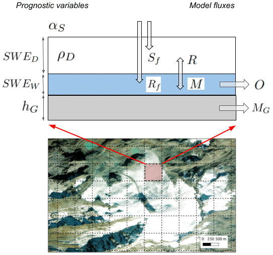

.. _appendix-s3m:

Appendix B: S3M
===============

Snow Multidata Mapping and Modeling (S3M) is CIMA Research Foundation's
distributed model for seasonal snow and glaciers. Snow and ice store water
and release it during melting; their evolution matters for downstream water
availability and hydrological forecasting. The `CIMA model presentation`_
explains this connection and S3M's use alongside Continuum.

Snow, ice and meltwater
-----------------------

   S3M snow and glacier stores and water exchanges. Avanzi et al. (2022),
   Figure 1, reproduced unchanged under CC BY 4.0. Background imagery credit:
   ESRI Satellite, as identified in the original caption.
   See the :download:`figure source manifest <_static/images/models/SOURCES.txt>`.

The `S3M 5.1 paper`_ describes precipitation partitioning between rain and snow,
separate dry- and wet-snow storage, refreezing, liquid-water release and glacier
mass balance. Its melt formulation combines temperature and radiation effects.
The glacier representation includes spatial ice-thickness change and the
influence of debris on melting. Observational information can be incorporated
through data assimilation.

Results include snow water equivalent, snow depth and density, snow liquid-water
content, albedo, meltwater release and glacier evolution. These describe both
the amount of stored water and its seasonal release. The paper evaluates the
model in the northwestern Italian Alps; the results concern that study and
configuration, rather than guaranteeing performance in every domain.

Relationship with HMC and SHYBOX
--------------------------------

S3M describes the snow and ice contribution to water availability; Continuum
describes catchment water movement and discharge. Their complementary roles
motivate the coupling discussed in the `CIMA model presentation`_.

SHYBOX provides dataset preparation, file planning, configuration and execution
workflows around the separate S3M numerical engine. See :doc:`dataset_planning`
for input organization, :doc:`runners` for model execution and :doc:`appendix_hmc`
for the Continuum overview. Installing SHYBOX alone does not supply model
executables or a domain's geographic and meteorological inputs.

The scientific reference describes S3M **5.1**. The SHYBOX runner guide also
documents a **5.3.3** namelist template. Use the executable and configuration
that match your application; these version numbers identify different artifacts.

Sources and further reading
---------------------------

* Avanzi et al. (2022). `S3M 5.1 model description <https://doi.org/10.5194/gmd-15-4853-2022>`_,
  Geoscientific Model Development, 15, 4853–4879. Open-access scientific
  reference and source of the model illustration; CC BY 4.0.
* CIMA Research Foundation (3 May 2021). `CIMA model presentation`_:
  an introduction to snow, glacier water resources and coupling with Continuum.

.. _S3M 5.1 paper: https://gmd.copernicus.org/articles/15/4853/2022/gmd-15-4853-2022.html
.. _CIMA model presentation: https://www.cimafoundation.org/news/s3m-un-modello-per-neve-e-ghiacciai/
