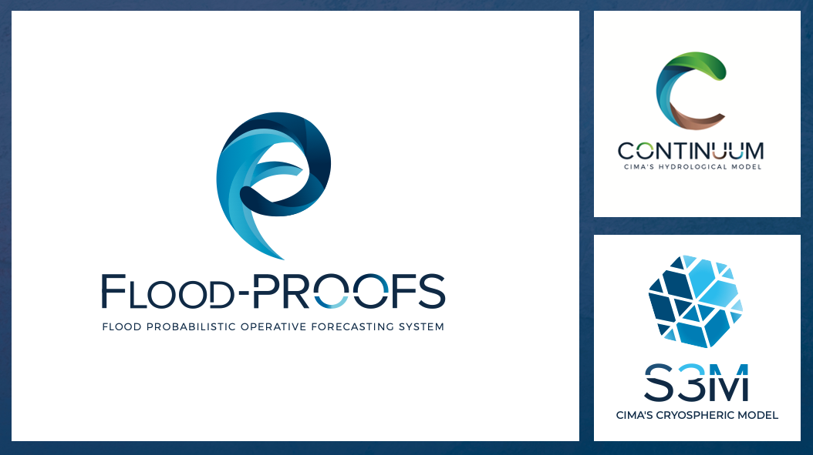

Overview and repository structure
=================================

SHYBOX separates reusable processing code, workflow configuration and data
distribution. It supports workflows around HMC (Hydrological Model Continuum)
and S3M (Snow Multidata Mapping and Modeling), alongside dataset conversion,
interpolation, merging and analysis.

The model presentations are collected in :doc:`appendix_hmc` (Appendix A) and
:doc:`appendix_s3m` (Appendix B). Algorithm procedures, configuration and operating
examples are maintained in this documentation; the repository README provides
a general project introduction.

   Flood-PROOFS, Continuum and S3M: forecasting and modeling tools in the
   ecosystem supported by SHYBOX workflows.

Repository layout
-----------------

.. code-block:: text

   shybox/
   ├── shybox/                    Reusable Python package
   ├── workflow/                  Workflow drivers and JSON examples
   │   ├── dataset/               Convert, merge and disaggregate data
   │   ├── geo/                   Prepare geographic information
   │   ├── runner/
   │   │   ├── datasets/          Plan and compose observed/forecast forcing
   │   │   ├── datasets_mode/     Stage deterministic fields and update members
   │   │   └── execution/         Configure and execute HMC/S3M
   │   ├── analyzer/              Analyze model output
   │   └── monitoring/            Monitor lifecycle and resources
   ├── hydrapp/                   Flask figures, section maps and run monitoring
   ├── apps/                      Additional applications
   ├── web/                       Earlier visualization application
   ├── docker/                    Container definitions and entrypoints
   ├── apptainer/                 Apptainer deployment notes
   ├── hpc/                       HPC execution material
   ├── utils/                     Standalone utilities
   ├── tests/                     Checks, examples and fixtures
   ├── docs/                      Documentation
   ├── pyproject.toml             Package metadata
   └── setup_shybox_*.sh          Conda environment setup

Some local checkouts also contain ``conda/``, ``dset/``, ``exec/`` and ``tmp/``. These
hold environments, datasets and temporary files and are ignored by Git.

Core package
------------

The reusable package is organized by responsibility: configuration, time and
dataset access; file I/O and geospatial helpers; processing adapters; workflow
orchestration; dataset and model runners; monitoring and publishing; optional
external integrations. :doc:`toolkits` lists every toolkit directory, its main
interfaces and a suggested use. :doc:`applications` maps those toolkits to the
runnable applications in ``workflow/``.

Data and models
---------------

Obtain datasets separately from `SHYDATA <https://github.com/c-hydro/shydata>`_
or your operational data sources. Dataset paths, geographic domains, model
executables and model versions must match the workflow settings. A Python
environment alone does not provide the compiled HMC/S3M engines or their inputs.

   Mountain terrain and valley landscapes from SHYBOX's existing image collection.
